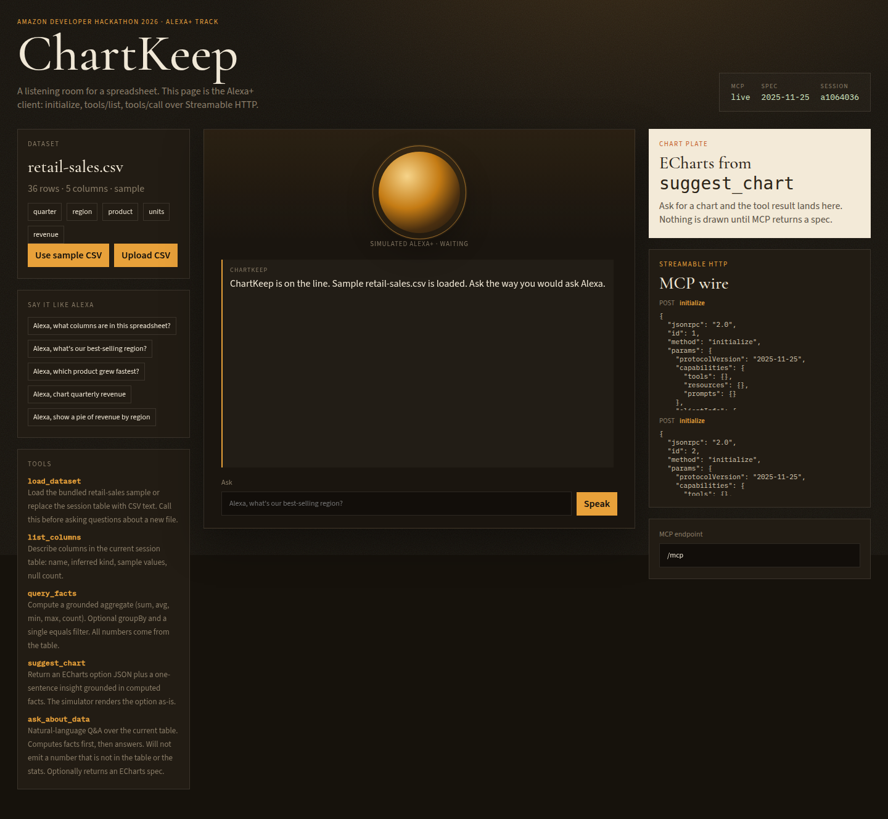
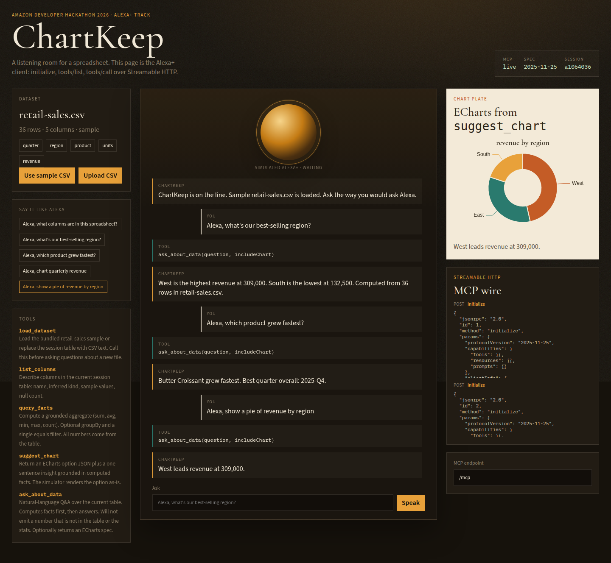

# ChartKeep MCP

Self-hosted [MCP](https://modelcontextprotocol.io/specification/2025-11-25) server plus a web page that acts as an Alexa+ client. Ask a spreadsheet a question in the voice you would use on Alexa. The server computes facts from the CSV first, then answers. Charts are ECharts JSON returned by a tool, not guessed in the browser.

Built for the Amazon Developer Hackathon 2026 Alexa+ track. Amazon's Alexa+ MCP Toolkit and Web Simulator are partner-preview only, so this repo uses the path the FAQ allows: a Streamable HTTP MCP server (spec `2025-11-25`) and a web client that sends `initialize`, `tools/list`, and `tools/call`.

No Amazon private SDK. No API keys. The sample table never leaves your machine.

## Run

Needs Node 20+ and npm. Bun is not required.

```bash
npm install
npm run dev
```

Then open [http://127.0.0.1:5173](http://127.0.0.1:5173).

That starts two processes:

| Process | URL |
|---|---|
| MCP server (Streamable HTTP) | `http://127.0.0.1:8787/mcp` |
| Alexa+ simulator (Vite) | `http://127.0.0.1:5173` |

The simulator proxies `/mcp` to port 8787 so the browser does not have to fight CORS during the demo. Health check: `http://127.0.0.1:8787/health`.

## What you should see

1. The page connects and the MCP badge turns live. The wire log shows `initialize` (`2025-11-25`) and `tools/list`.
2. `retail-sales.csv` loads through `load_dataset` (36 rows of cafe sales by quarter, region, and product).
3. Click a voice chip, or type `Alexa, what's our best-selling region?`.
4. The transcript shows the tool call, then a spoken answer. If the question wants a chart, the paper plate on the right renders the ECharts spec from the tool result.





Upload any other CSV the same way. `list_columns`, `query_facts`, and `suggest_chart` keep working on the new table.

## Tools

| Tool | What it does |
|---|---|
| `load_dataset` | Load `samples/retail-sales.csv` or replace the session table with CSV text |
| `list_columns` | Name, inferred kind, samples, null count |
| `query_facts` | `sum` / `avg` / `min` / `max` / `count`, optional `groupBy` and one equals filter |
| `suggest_chart` | ECharts option JSON plus a one-line insight |
| `ask_about_data` | Voice-style Q&A. Facts first. Numbers that are not in the table or the stats get dropped |

There is also a `dataset://current` resource and a `voice-sales-brief` prompt.

The grounded-facts idea comes from [plotkeep](https://github.com/sherotree/plotkeep): compute min/max/change/growth in code, then write the sentence from those numbers.

## How this maps to Alexa+

Alexa+ talks to brand add-ons over MCP Streamable HTTP. This repo does the same handshake a real Alexa+ client would:

```
simulator (this web page)
    POST /mcp  initialize          → MCP-Session-Id
    POST /mcp  notifications/initialized  → 202
    POST /mcp  tools/list
    POST /mcp  tools/call  name=ask_about_data | suggest_chart | …
```

Responses are JSON (`enableJsonResponse: true`). The client also parses `text/event-stream` if a server streams SSE, which the spec requires.

When partner tooling opens up, point Alexa+ at a public HTTPS URL for `/mcp`. Until then, this page is the client.

## Layout

```
samples/retail-sales.csv   bundled cafe sales
server/                    Node + TypeScript MCP server
  src/index.ts             Express + StreamableHTTPServerTransport
  src/createServer.ts      tool / resource / prompt registration
  src/csv.ts               quoted CSV, kinds
  src/facts.ts             series stats + contradiction check
  src/query.ts             aggregates
  src/chart.ts             ECharts specs
  src/ask.ts               voice-style intent → facts → answer
simulator/                 Vite + React + TypeScript client
  src/mcp/client.ts        Streamable HTTP (JSON and SSE)
  src/agent/router.ts      utterance → tools/call
FRICTION.md                hackathon friction log
DEMO.md                    ≤3 minute video script
```

Stack: `@modelcontextprotocol/sdk` 1.32 (spec 2025-11-25), Express 5, Zod 3, Vite 7, React 19, ECharts 5. MIT.

## Tests

```bash
npm test
```

Covers CSV parse, West as the top region, Butter Croissant as fastest growth, and a pie spec.

## Deploy notes

A local run is enough for the hackathon. Judges can clone and run the two commands above.

If you want a public URL later:

- Keep the server on `127.0.0.1` unless you add auth. The MCP spec warns about DNS rebinding.
- Tunnel with `cloudflared` (or similar) to expose `/mcp` as HTTPS.
- Alexa+ production also wants OAuth 2.1 + PKCE. That is out of scope here because the partner console is not available to entrants.
- No `.env` secrets are used. Do not add keys to the repo.

## License

[MIT](LICENSE) © 2026 sherotree
